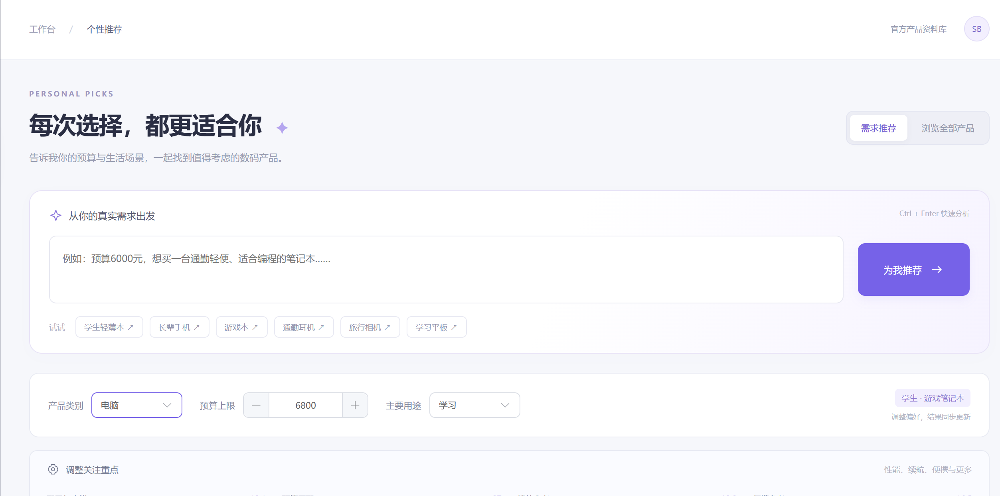
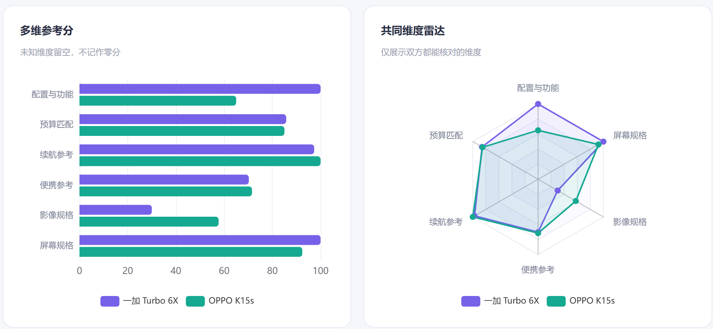
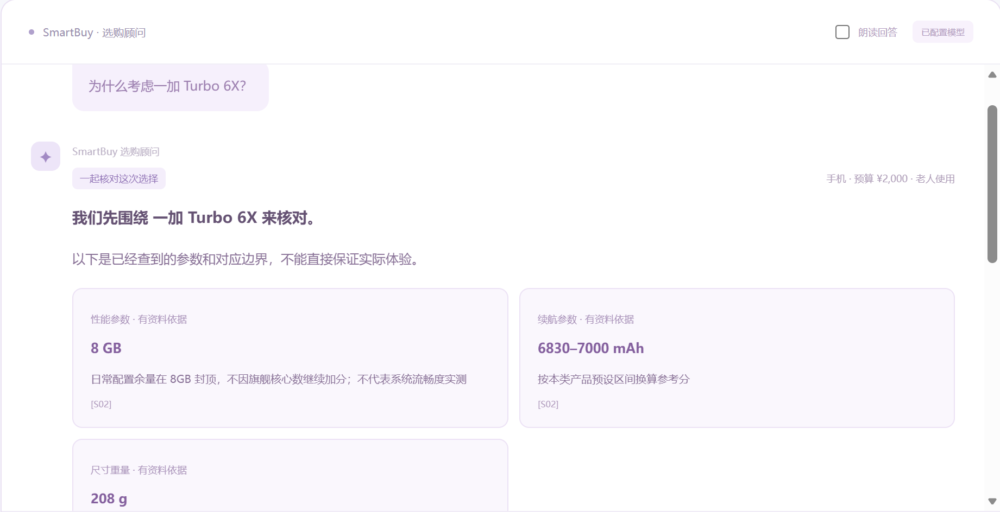
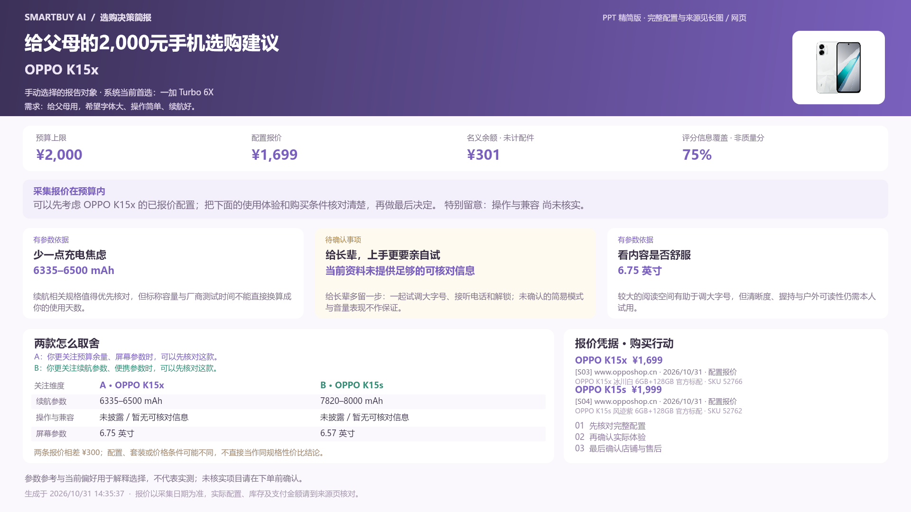
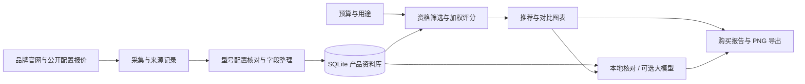

# SmartBuy AI · 数码选购可视化助手

将购买需求转化为有依据的选择：从预算与用途出发，完成产品筛选、多维对比、上下文问答和选购报告。

覆盖 **手机、电脑、平板、耳机、相机** 五大品类。使用 Vue 3、Element Plus、ECharts、Flask 与 SQLite 构建，支持本地运行。



## 四个相互衔接的模块

| 模块 | 可以做什么 |
| --- | --- |
| 个性推荐 | 输入自然语言需求，提取预算和用途；调整关注权重；查看筛选过程、TOP 标识与推荐依据；浏览全部产品。 |
| 产品对比 | 自由选择同品类的两款产品；柱状图与雷达图比较；固定产品表头、分组导航、隐藏相同项和差异高亮。 |
| 购买报告 | 汇总需求、配置报价、推荐理由、两款取舍和购买提醒；网页阅读、图片预览与 PNG 导出；支持 16:9 简报和完整长图。 |
| 智能助手 | 围绕当前预算和产品连续追问，解释依据、寻找替代产品并跳转对比和报告；可配置兼容的对话服务，支持浏览器语音输入与回答朗读。 |





## 快速启动

准备 **Python 3.10+** 和 **Node.js 20.19+ / 22.12+**。首次安装需要联网下载依赖。

Windows：下载或克隆本仓库，双击根目录 `start-smartbuy.cmd`。首次运行将创建独立 Python 环境、安装依赖并构建网页，然后打开 <http://127.0.0.1:8000>。

手动启动（Windows / macOS / Linux）：

```sh
python -m venv .venv
# Windows PowerShell:
.venv\Scripts\Activate.ps1
# macOS / Linux 改为：source .venv/bin/activate
python -m pip install -r backend/requirements.txt
cd frontend
npm ci
npm run build
cd ..
python backend/app.py
```

首次启动会自动从随仓库提供的产品 JSON 数据建立本机数据库；无需申请购物平台 API 就能使用产品浏览、参数对比、本地助手和报告功能。大模型问答需要自行配置服务。

## 数据与报价说明

- 本仓库提供项目采集的**历史产品资料**、配置报价、图片及来源索引。实际数量见 [数据说明](docs/数据与采集说明.md) 和 `backend/data/seed_manifest.json`。
- 报价保留具体配置、来源、条件和采集时间；按有效期参与预算筛选。过期或未取得合格报价的产品会进入待核价状态，不按零元参与推荐。
- 京东、淘宝、拼多多、闲鱼提供查价跳转入口；查价入口不代表已获得该平台实时报价。平台接口需要各自账号及权限，密钥不随代码发布。
- 采集脚本可手动执行；每日更新属于可配置的运行策略，本仓库没有预装后台定时任务。截图中的日期、价格和排序属于对应历史场景。

## 技术路线



## 目录与更多说明

```text
SmartBuy-AI/
├─ backend/               Flask 接口、推荐评分、采集工具和后端测试
│  ├─ data/               产品种子库、产品图片与展示测试样例
│  └─ tests/
├─ frontend/              Vue 界面、图表、报告绘制与前端测试
├─ docs/                  使用说明、数据说明、接口文档与截图
├─ Setup-SmartBuy.ps1     Windows 首次安装或重新构建
├─ Start-SmartBuy.ps1     Windows 启动
└─ start-smartbuy.cmd     双击入口
```

- [快速开始与开发调试](docs/快速开始.md)
- [项目结构与实现](docs/项目结构与实现.md)
- [数据与采集说明](docs/数据与采集说明.md)
- [接口说明](docs/接口说明.md)
- [配置与常见问题](docs/配置与常见问题.md)
- [测试说明](docs/测试说明.md)

## 配置大模型

进入网站“智能助手 → 模型设置”，填写服务地址、模型名称和 API 密钥，测试连接后保存。配置仅存于本机后端，公开仓库不包含密钥。也可使用 `backend/.env.example` 创建本机 `.env`，详见配置说明。

## 验证代码

```sh
python -m unittest discover -s backend/tests -v
cd frontend
npm run build
npm test
```

更多页面联调与报告绘制检查见测试说明。测试通过不等同于外部平台接口已开通，也不表示历史报价一直有效。

## 资料使用

这是课程项目的整理发布版本。第三方产品名称、商标、图片和参数资料归相应权利人所有，来源保留于产品记录中；请勿将资料目录理解为对第三方素材的重新授权。仓库不包含个人课程论文、PPT、浏览行为记录、服务密钥或本机运行环境。
