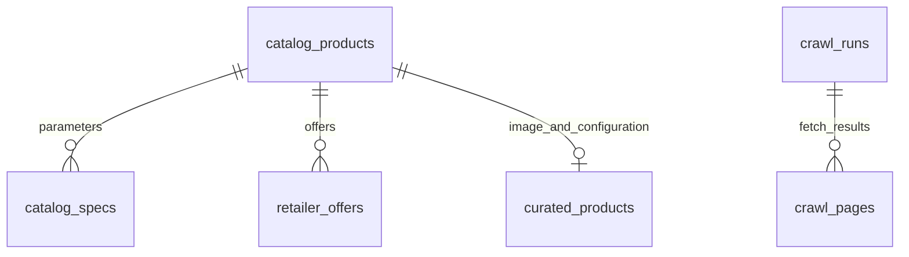

# 数据与采集说明

## 随仓库提供的数据

种子库由项目运行库抽取产品资料表生成，保留原始记录 ID、来源、采集时间与配置报价，不包含用户行为、个人设置、密钥或旧版示例商品表。

| 品类 | 已通过项目校验的产品记录 |
| --- | ---: |
| 平板 | 14 |
| 手机 | 58 |
| 电脑 | 62 |
| 相机 | 17 |
| 耳机 | 21 |

完整表级统计见 `backend/data/seed_manifest.json`。产品、型号、配置、参数条目和报价条目是不同统计口径，不能相互替代。

## 主要关系



- 产品表：名称、品牌、品类、地区、来源、采集时间、校验状态。
- 参数表：产品 ID、分组、参数名、原文值、来源和时间。
- 报价表：平台、店铺、配置、金额、币种、地区、状态、条件、来源及时间。
- 精选表：具体配置说明、图片地址、图片来源与哈希。

## 数据处理

采集 → 记录来源与时间 → 解析参数 → 品牌和品类归一 → 区分型号与配置 → 报价条件核对 → 保存数据库 → 资格筛选与可视化。

无报价保留未知状态；人民币、地区、库存/状态、商品成色与时效按业务规则核对。默认报价有效期为 7 天，历史记录不等于当前成交价。未核实的产品可以隔离，避免进入正式候选。

产品图片原文件随仓库保留。较大的网页原文快照不在公开整理包中，数据库仍保留来源 URL、原始参数值和快照索引。因此 `audit_catalog.py` 会将未携带的快照列为 `missing_snapshots`，不伪称已完成原文哈希复核。重新采集可在本机产生快照。

## 手动更新

先激活 Python 环境，在项目根目录执行：
```sh
python backend/crawl_catalog.py --pending
python backend/crawl_prices.py
```

来源可由 `--sources` 指定：
```sh
python backend/crawl_catalog.py --sources backend/catalog_sources.json
python backend/crawl_stores.py --sources backend/curated_store_sources.json --limit 10
python backend/build_curated.py --download
```

`crawl_lenovo_list.py`、`crawl_marketplaces.py`、`extract_official_pdf.py` 提供补充采集方式；先查看脚本与 `--help`。第三方网页可能变化、限制访问或要求平台权限，采集不能保证每次取得报价。请遵循来源站点规则，不绕过登录、验证码或平台访问控制。

## 更新频率

可将脚本交由本机任务计划程序按日执行，实际成功时间以数据库记录为准。此仓库不预置定时任务，也不把历史数据日期改成“今天”。
