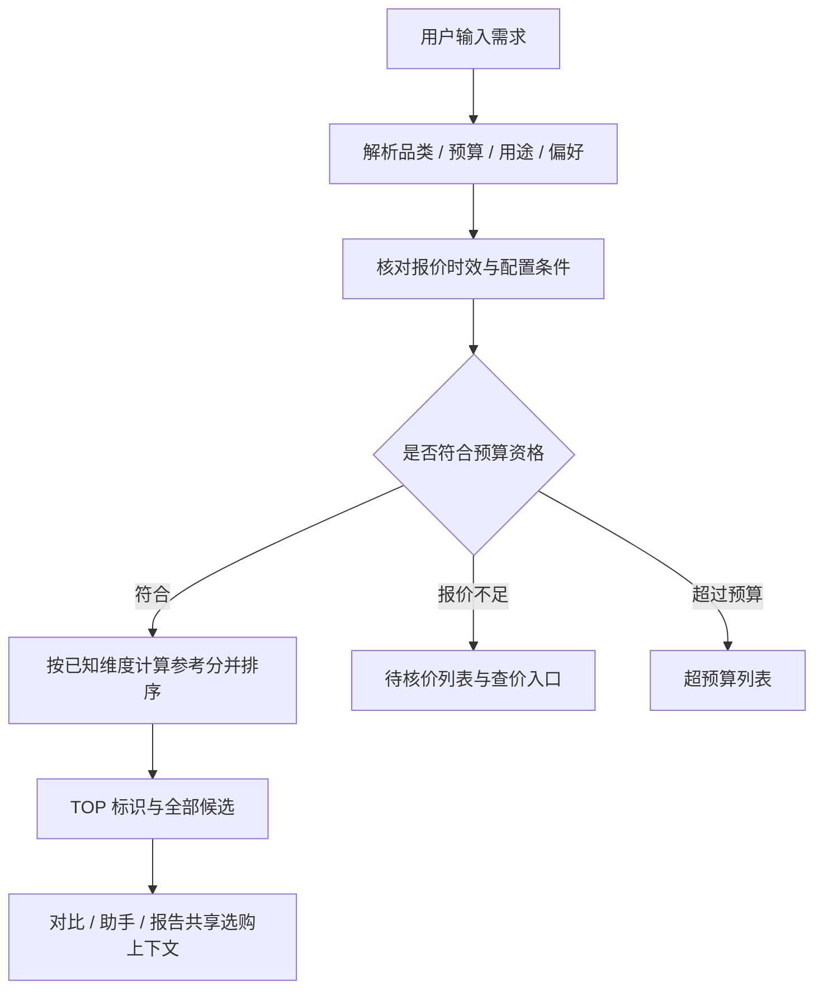

# 项目结构与实现

## 后端模块

| 文件 | 职责 |
| --- | --- |
| app.py | Flask 入口、静态网页、需求解析与主要业务接口 |
| catalog.py / catalog_schema.sql | 产品目录、参数、图片与数据库初始化 |
| profiles.py / recommendations.py | 需求条件、候选筛选与推荐结果 |
| scoring.py / pricing.py | 各维度参考分、权重、报价资格与时效判断 |
| comparison.py | 两款产品的分组参数和差异比较 |
| reporting.py | 结构化选购报告 |
| assistant.py / assistant_engine.py | 模型配置、调用、语音转写、上下文问答与行动结果 |
| shopping.py / marketplace_quotes.py | 购物平台跳转、报价适配和资格判断 |
| taobao_api.py | 可选淘宝联盟配置、请求签名与接口适配 |
| crawl_catalog.py / crawl_prices.py / crawl_stores.py | 官网参数与公开价格采集 |
| build_curated.py | 精选产品资料与图片整理 |
| audit_*.py / revalidate_catalog.py | 数据与展示场景诊断 |

其他来源 JSON、探测和修复脚本保留以方便继续研究；运行前请阅读对应脚本，避免覆盖本机资料。

## 前端模块

`App.vue` 负责四大模块导航；`Personalized.vue` 与 `Catalog.vue` 负责需求推荐和目录；`Comparison.vue` 负责产品对比；`PurchaseReport.vue`、`ReportReading.vue` 与 `reportCanvas.js` 负责报告阅读及图片导出；`AssistantPage.vue`、`AssistantAnswer.vue` 与 `advisorContext.js` 负责问答和跨模块上下文；`voiceInput.js` 处理语音识别状态；`ShoppingLinks.vue`、`ProductImage.vue` 统一报价入口和图片展示。

## 从数据到推荐

未知参数保留未知状态，不强行补成零分；参考分用于解释当前资料和偏好，不代表实验室实测成绩。报告中的两款取舍同时展示各自依据。

## 扩展建议

增加数据源：优先在来源 JSON 和对应采集适配器中增加解析规则，保留原文来源、型号、地区和配置。

增加模型服务：使用兼容对话接口的服务，在本机配置地址、模型名与密钥。

部署到公网：当前版本面向本地课程展示，接口有本机访问保护；需要另外设计用户身份、服务进程、反向代理与密钥管理，再调整访问边界。
